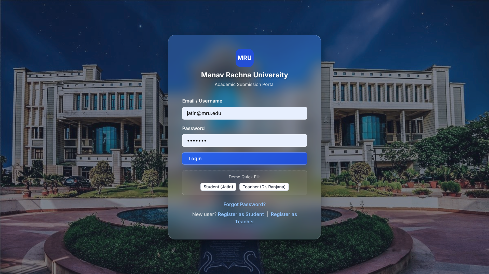
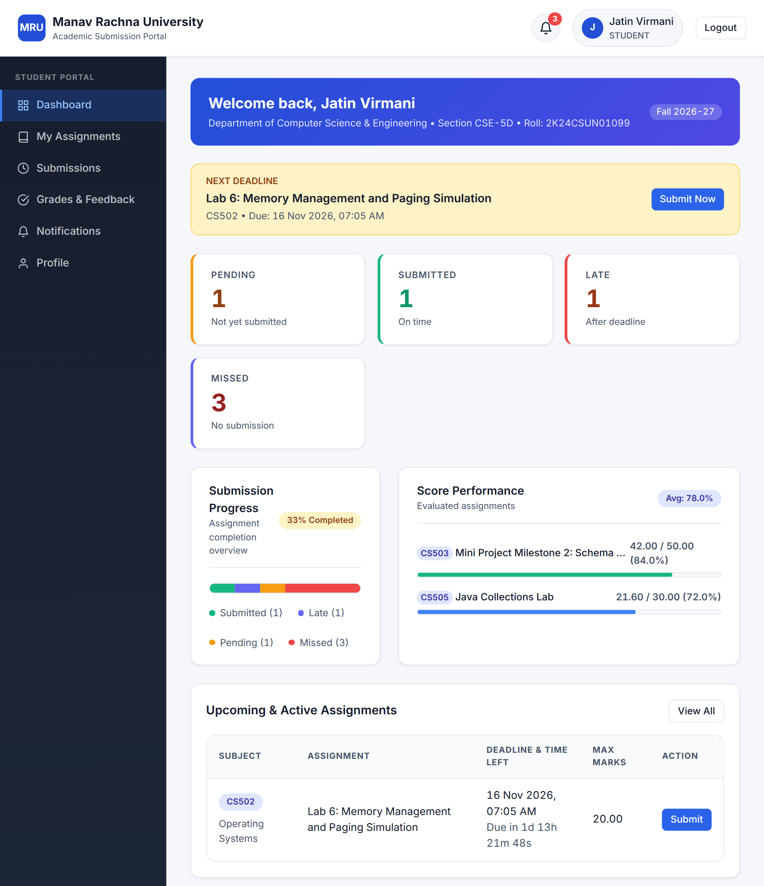
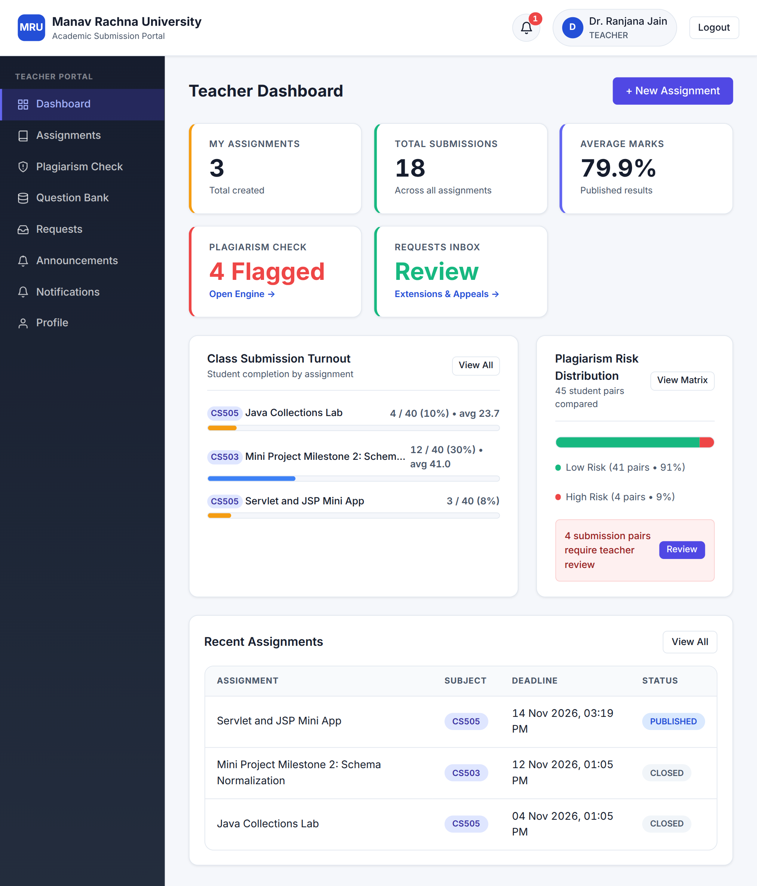
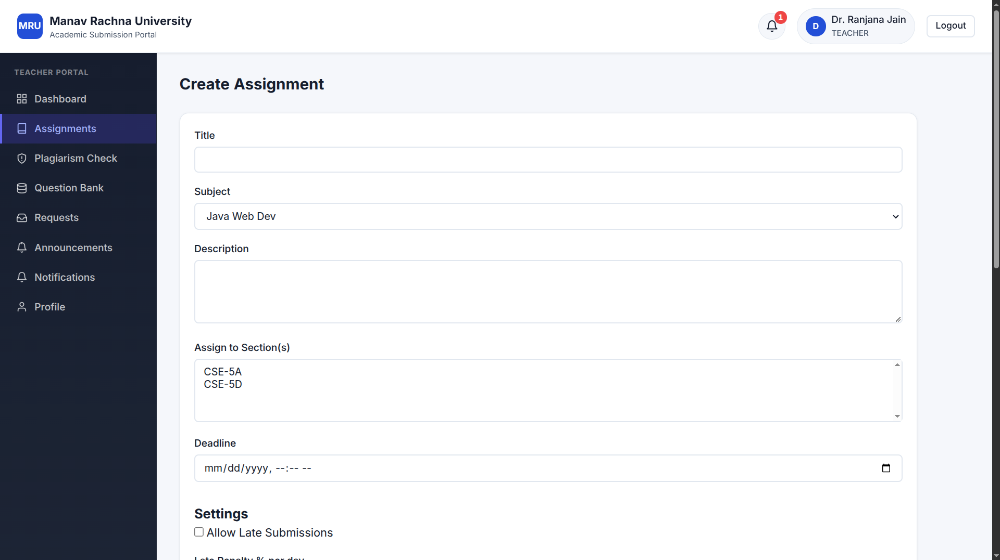
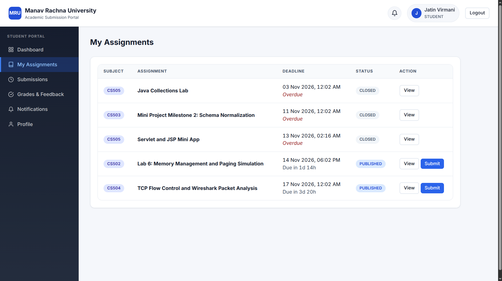
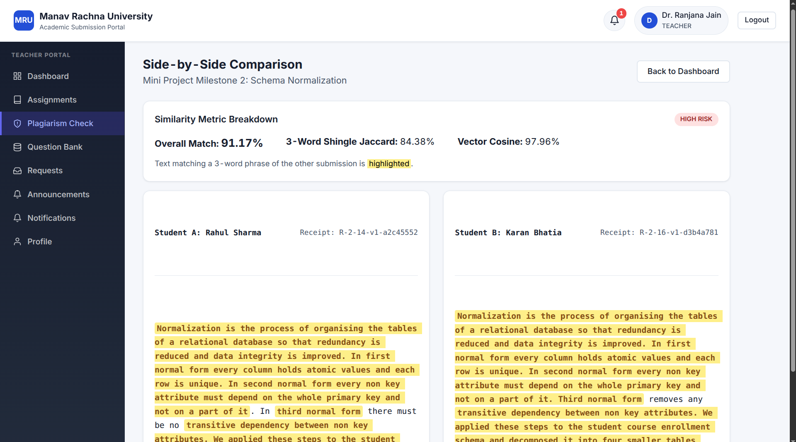

# Online Assignment Submission System (OASS)

**Developer:** Jatin Virmani  
**Roll Number:** 2K24CSUN01099  
**Branch & Section:** B.Tech CSE, 5D  
**University:** Manav Rachna University (MRU), Faridabad  
**Supervisor / Faculty Guide:** Dr. Ranjana Jain

---

## 1. Project Introduction
The Online Assignment Submission System (OASS) is an academic assignment management and evaluation portal built using Java (Jakarta Servlets 6.0, JSP 3.1, JSTL 3.0, JDBC) and MySQL on Apache Tomcat 10.1.

The portal serves two primary user roles:
* **Student Portal:** View published assignments, track relative deadlines, upload assignment files with cryptographic SHA-256 receipts, inspect rubric grading and faculty feedback, and submit deadline extensions or regrade appeals.
* **Teacher Portal:** Create assignments with multi-section targeting and custom rubrics, monitor class submission turnout in real time, grade submissions with automated late penalties, and execute native plagiarism analysis.

---

## 2. Application Showcase

### Authentication & Student Dashboard
<p align="center">
  
</p>
<p align="center">
  <em>Glassmorphism Login with MRU Campus Theme</em>
</p>

### Student Dashboard & Teacher Dashboard
<p align="center">
  
  
</p>
<p align="center">
  <em>Left: Student Dashboard with Visual Progress & Score Charts | Right: Faculty Dashboard with Class Turnout</em>
</p>

### Faculty Assignment Publishing
<p align="center">
  
</p>
<p align="center">
  <em>Faculty Assignment Publisher with Multi-Section Target, Late Submission Penalty Policy & Rubric Schemes</em>
</p>

### Assignment Management
<p align="center">
  
</p>
<p align="center">
  <em>Assignment Deadlines & Live Status Tracking </em>
</p>

### Assignment Plagiarism Check & Side-by-side Comparison
<p align="center">
  
  
</p>
<p align="center">
  <em>Left: Assignment Plagiarism Detection Engine | Right: Side-by-side Comparison</em>
</p>

---

## 3. Key Technical Highlights

### Plagiarism Detection (Set Theory & Vector Modeling)
A custom plagiarism detection engine implemented natively in Java without third-party APIs:
* **3-Word Shingling (Jaccard Similarity):** Deconstructs submitted text into word n-grams ($n = 3$) and computes set intersection over set union:
  $$\text{Jaccard}(A, B) = \frac{|A \cap B|}{|A \cup B|}$$
* **Word-count Vector Cosine Similarity:** Measures vector overlap based on word frequencies:
  $$\text{Cosine}(A, B) = \frac{\vec{A} \cdot \vec{B}}{\|\vec{A}\| \|\vec{B}\|}$$
* **Composite Score & Classification:** Calculates a weighted composite score ($0.50 \times \text{Jaccard} + 0.50 \times \text{Cosine}$). A pair is **HIGH RISK** at or above the assignment's plagiarism threshold (default $70\%$) and **MEDIUM RISK** within 30 points below it (default $40\%$ to $69\%$).
* **Side-by-Side Review:** Shows both submissions next to each other with every phrase that appears in both texts highlighted.
* **Text extraction:** PDF files are read with Apache PDFBox, DOCX with Apache POI, and `.txt`/source files directly, so plagiarism works on all of them.

### Submission Integrity & Cryptographic Hashing
* Uploaded files are hashed using the **SHA-256** cryptographic algorithm upon receipt.
* Every upload is saved on disk under a random UUID name (folder `upload.dir`, default `~/oass-data/uploads`); the original name is kept only in the database.
* Before saving, the server checks that the assignment is published, belongs to the student's section, is inside the deadline/hard cutoff, and that the file type and size are allowed.
* An immutable digital receipt code (e.g. `REC-2024-CS505-A1-V1-7F3A9C`) is computed and returned to the student as proof of timely submission.
* Re-submissions automatically increment version numbers ($V1, V2, \dots$) while preserving full revision history.

### Grading, Late Penalty and Reports
* The evaluation page loads the real rubric of the assignment; a teacher can **Save Draft** (hidden from the student) or **Finalize & Publish**.
* The **late penalty is calculated automatically** from the assignment's rules (percent per started day, up to a maximum).
* Rubric scores and the evaluation are saved in one database transaction (the same for assignment + rubric when a teacher creates an assignment).
* Teachers can **export the marks of a whole section as CSV**; the teacher dashboard shows the average marks.
* Deadlines count down live in the browser and turn red when less than 2 hours are left.

### Automated 2-Hour Deadline & Email Reminders
* Built using **Jakarta Mail** and Java's background `ScheduledExecutorService` (`ReminderService.java`), started automatically with the application (`AppStartListener`).
* Runs in the background **every 2 minutes**.
* When an assignment is within **2 hours of its deadline**, it detects enrolled students who have not yet submitted and dispatches:
  1. An in-app urgent notification to the student portal.
  2. An email alert to the student's email address with assignment details and submission link.
  3. A row in `reminder_log`, so each student receives the reminder only once per assignment.
* If the email cannot be delivered (for example wrong SMTP settings), the reminder is **not** logged as sent and is retried on the next run.
* If no SMTP host is configured, the email is printed to the server log instead of being sent (useful for local development).

### Layered MVC Architecture
* **Model:** Plain Old Java Objects (`Assignment`, `Student`, `Teacher`, `User`, ...) and Data Access Objects (`AssignmentDao`, `SubmissionDao`, `EvaluationDao`, `PlagiarismDao`, `UserDao`, `NotificationDao`, ...).
* **Service layer:** Business logic (`SubmissionService`, `EvaluationService`, `PlagiarismService`, `ReminderService`, `EmailService`) kept out of the controllers.
* **View:** JSP files utilizing JSTL core tags (`<c:forEach>`, `<c:if>`, `<c:choose>`, `<c:out>`) and a shared master template (`layout.tag`).
* **Controller:** HTTP Servlets mapping `GET` requests to forward views and `POST` requests following the **Post-Redirect-Get (PRG)** pattern to prevent duplicate form submissions.
* **Security:** `AuthFilter` enforces login and role boundaries (student vs. teacher) on every protected URL.

---

## 4. Technology Stack
* **Language:** Java 21
* **Web Technologies:** Jakarta EE 10 (Servlet 6.0, JSP 3.1, JSTL 3.0)
* **Database:** MySQL 8.0+ via MySQL Connector/J (InnoDB, utf8mb4)
* **Libraries:** Apache PDFBox, Apache POI, Jakarta Mail (Eclipse Angus), JUnit 5
* **Build & Dependency Management:** Apache Maven
* **Servlet Container:** Apache Tomcat 10.1 (via Cargo Maven Plugin)
* **Styling:** CSS3 (Variables, Flexbox, Grid, Glassmorphism, Mobile Responsive)

---

## 5. Setup and Installation

### Prerequisites
* Java JDK 21 installed (`java -version`)
* Apache Maven installed (`mvn -version`)
* MySQL Server installed and running (`mysql --version`)

### Step 1: Database Initialization
Run the database creation script and sample demo data:
```bash
mysql -u root -p < db/schema.sql
mysql -u root -p oass < db/seed.sql
```

### Step 2: Configuration
Create a configuration file at `~/oass-data/config.properties` (outside the project folder, so your passwords are never committed to Git). A template is provided in `config.properties.example`.

```properties
# Database (required)
db.url=jdbc:mysql://localhost:3306/oass?useSSL=false&allowPublicKeyRetrieval=true&serverTimezone=Asia/Kolkata
db.user=your_mysql_username
db.password=your_mysql_password

# Email reminders (optional)
# Leave these out and emails are only printed to the server log.
smtp.host=smtp.gmail.com
smtp.port=587
smtp.user=your@gmail.com
smtp.password=your_gmail_app_password
smtp.from=your@gmail.com
```

> **Gmail note:** use an [App Password](https://myaccount.google.com/apppasswords) (requires 2-Step Verification), not your normal Gmail password.

### Step 3: Run the Application
Start the embedded Tomcat server:
```bash
mvn cargo:run
```
Once deployed, open your browser at:
`http://localhost:8080/oass/login`

> If the server runs in a different time zone, start it with `-Duser.timezone=Asia/Kolkata` so the 2-hour reminder window is calculated correctly.

---

## 6. Demo Accounts

All sample accounts are pre-loaded with the password: `pass123` (sample data only, change it for any real deployment).

| Role | Name | Email | Password |
|---|---|---|---|
| **Student** | Jatin Virmani | `jatin@mru.edu` | `pass123` |
| **Teacher** | Dr. Ranjana Jain | `teacher@mru.edu` | `pass123` |

---

## 7. Testing the Email Reminder

1. Configure SMTP in `~/oass-data/config.properties` (see Step 2) and restart the server.
2. Set a student's email to an inbox you can open, and create (or edit) a published assignment for that student's section with a deadline about 90 minutes from now. The student must not have submitted it yet.
3. Watch the server log:
   ```bash
   tail -f $CATALINA_HOME/logs/catalina.out | grep -iE "reminder|email"
   ```
4. Within 2 minutes the log shows `2-hour deadline reminder sent to ...` and the email arrives in the inbox.
5. Verify in MySQL:
   ```sql
   SELECT * FROM reminder_log;
   ```
6. To test again, run `DELETE FROM reminder_log;`.

---

## 8. Directory Layout

```text
oass/
├── db/
│   ├── schema.sql           # Database schema and relational constraints
│   └── seed.sql             # Test dataset with sample users and submissions
├── screenshots/             # Application screenshots for GitHub showcase
├── src/
│   ├── main/
│   │   ├── java/com/oass/
│   │   │   ├── controller/  # Servlets handling requests (auth, student, teacher)
│   │   │   ├── dao/         # Data Access Objects executing JDBC queries
│   │   │   ├── filter/      # AuthFilter enforcing session and role boundaries
│   │   │   ├── listener/    # AppStartListener (starts the reminder scheduler)
│   │   │   ├── model/       # POJOs and enums
│   │   │   ├── service/     # Business logic (Email, Reminder, Submission, Evaluation, Plagiarism)
│   │   │   └── util/        # Config, Db, DBUtil, FileStorage, HashUtil, TextExtractor, TimeUtil
│   │   ├── resources/       # Configuration and logging files
│   │   └── webapp/
│   │       ├── assets/      # CSS stylesheet and university imagery
│   │       ├── WEB-INF/
│   │       │   ├── tags/    # Common layout tag
│   │       │   └── views/   # JSP views for student and teacher roles
│   │       └── index.jsp    # Default redirector
│   └── test/                # Unit tests
├── Dockerfile               # Multi-stage Docker deployment (e.g. Render)
├── pom.xml                  # Maven project configuration
├── config.properties.example # Safe template for configuration (no real secrets)
├── .gitignore               # Keeps config.properties and build output out of Git
└── README.md                # Project documentation & showcase
```
